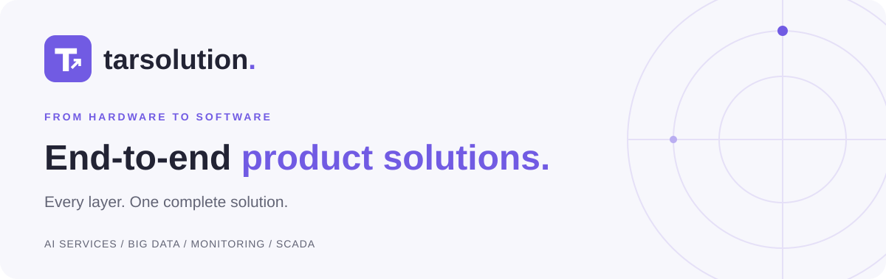

  <a href="https://tarsolution.com/">Explore our work</a> &nbsp; · &nbsp;
  <a href="https://tools.tarsolution.com/">Try our tools</a> &nbsp; · &nbsp;
  <a href="https://tarsolution.com/#contact">Let's talk</a>

## Every layer connected. Built to work together.

We design and build connected products from the underlying hardware and infrastructure to the software people use. Our work brings **infrastructure, data, AI, and applications** together in one end-to-end approach.

## Meet our products

<table>
<tr>
<td width="33%" valign="top">
<h3>Tools Tarsolution</h3>

Practical tools for everyday digital tasks, built for developers and engineers.

<a href="https://tools.tarsolution.com/"><strong>Explore the tools →</strong></a>

</td>
<td width="33%" valign="top">
<h3>Tarvault</h3>

Discover Tarvault and its open-source synchronization agent, Tarvaultsync.

<a href="https://tarvault.tarsolution.com/"><strong>Discover Tarvault →</strong></a> <a href="https://github.com/tarsolution/tarvaultsync">View Tarvaultsync on GitHub</a>

</td>
<td width="33%" valign="top">
<h3>UPA</h3>

From production data collection to web-based monitoring and preventive analysis. UPAM hardware and UPAC software, built together.

<a href="https://tarsolution.com/upam.html"><strong>Explore UPA →</strong></a>

</td>
</tr>
</table>

## Areas of work

**AI services · Big data · Monitoring · SCADA**

We explore and build across software, data, and industrial systems, connecting the layers that make a complete product.

## Open source. Shared progress.

Open-source tools are part of how we build. We also provide support to help teams adopt, use, and maintain them.

**[Tarvaultsync](https://github.com/tarsolution/tarvaultsync)** is our local-first secret synchronization agent for Azure, GCP, Google Drive, and OneDrive. Explore the repository for its documentation and source code.

## Have something in mind?

Tell us about your project, ask about a product, or discuss support for our open-source tools.

**[Start a conversation →](https://tarsolution.com/#contact)** &nbsp; · &nbsp; [contact@fmarslan.com](mailto:contact@fmarslan.com)

---

Made with purpose. Driven by curiosity. <a href="https://tarsolution.com/">tarsolution.com</a>

